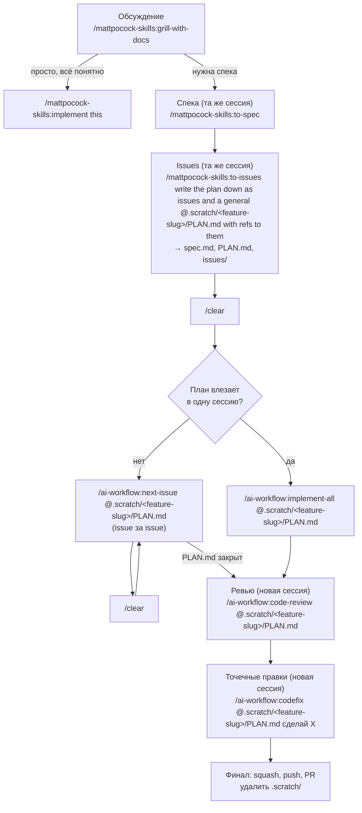

# AI-Workflow

Плагин Claude Code (`ai-workflow`, маркетплейс `whatislove118`) с пайплайном
«фича → PR»: команды-обёртки над скиллами `mattpocock-skills`.

## Установка (user scope)

```text
/plugin marketplace add Whatislove118/AI-Workflow
/plugin install ai-workflow
```

Плагин `mattpocock-skills` должен быть установлен отдельно — команды ниже на
него ссылаются.

## Список команд

| Команда | Назначение |
|---------|------------|
| [next-issue](commands/next-issue.md) | Реализует следующий тикет из плана (путь передаётся ссылкой в аргументе). |
| [implement-all](commands/implement-all.md) | Реализует все тикеты из плана (путь передаётся ссылкой в аргументе). |
| [code-review](commands/code-review.md) | Ревью тикетов и реализации плана (путь передаётся ссылкой в аргументе), с исправлением найденных проблем. |
| [codefix](commands/codefix.md) | Точечное изменение после реализации плана; в аргументе передаются ссылка на план и описание изменения. |

## Воркфлоу

| Воркфлоу | Назначение |
|----------|------------|
| [fix-ai-scan](workflows/fix-ai-scan.js) | Haiku ищет по репо комментарии `FIX-AI:`, Sonnet чинит каждый находкой отдельным патчем. Запуск: `/ai-workflow:fix-ai-scan` (опционально ссылка на план/тикет после команды, например `/ai-workflow:fix-ai-scan @.scratch/<feature-slug>/PLAN.md` — она передаётся каждому фиксу как контекст). |

## Хуки

| Хук | Событие | Назначение |
|-----|---------|------------|
| [check-update](hooks/check-update.sh) | `SessionStart` | Сравнивает установленную версию плагина с HEAD ветки `master` на GitHub; если они расходятся, пишет в чат предупреждение с командой `claude plugin update ai-workflow@whatislove118`. |

## Пайплайн: от фичи до PR

Идея: не тащить всю фичу в одной бесконечной сессии, а резать работу на этапы,
каждый — в своей сессии (меньше 100–200к контекста), с `/clear` между ними.
Живые артефакты каждого этапа — файлы в `.scratch/` (git-ignored), они и
передают контекст в следующую сессию.



1. **Обсуждение.**

   ```text
   /mattpocock-skills:grill-with-docs
   ```

   детали реализации сюда не тащите, дайте агенту самому прийти к решению.
   Если что-то пойдёт не так — всегда сможете его направить.

   Если задача простая и всё понятно как делать — можно писать

   ```text
   /mattpocock-skills:implement this
   ```

   и выполнять задачу.

2. **Спека (в этой же сессии).**

   ```text
   /mattpocock-skills:to-spec
   ```

   Создаётся спецификация по продукту, дизайну кода и так далее.

3. **Тикеты.** В той же сессии:

   ```text
   /mattpocock-skills:to-issues write the plan down as issues and a general @.scratch/feature-slug/PLAN.md with refs to them\n→ SPEC.md, PLAN.md, issues/
   ```

   Получаете:

   ```text
   .scratch/
   ├─ SPEC.md
   ├─ PLAN.md
   └─ issues/
      ├─ issue-1.md
      ├─ issue-2.md
      └─ ...
   ```

   Дальше сессию `/clear`.

4. **Реализация.** Если весь план укладывается в одну сессию:

   ```text
   /ai-workflow:implement-all @.scratch/<feature-slug>/PLAN.md
   ```

   Если нет — по тикету на сессию, с `/clear` между ними:

   ```text
   /ai-workflow:next-issue @.scratch/<feature-slug>/PLAN.md
   ```
   (делает тикет + коммит по завершению)

   Затем `/clear` и повтор `/ai-workflow:next-issue @.scratch/<feature-slug>/PLAN.md`,
   пока `PLAN.md` не закроется целиком.

5. **Ревью.** В свежей сессии, когда все тикеты готовы:

   ```text
   /ai-workflow:code-review @.scratch/<feature-slug>/PLAN.md
   ```

6. **Точечные правки.** Если после реализации нужно что-то доточить — новая
   сессия:

   ```text
   /ai-workflow:codefix @.scratch/<feature-slug>/PLAN.md сделай X
   ```

   Текст после команды (`$ARGUMENTS`) подставляется как есть — включайте
   в него и ссылку на план, и описание нужного изменения.

   Если правок много и они разбросаны по коду — разметьте нужные места
   комментариями `FIX-AI: ...` и прогоните
   [fix-ai-scan](workflows/fix-ai-scan.js):

   ```text
   /ai-workflow:fix-ai-scan @.scratch/<feature-slug>/PLAN.md
   ```

   Каждый найденный комментарий чинится отдельным патчем, со ссылкой на план
   как контекстом.

7. **Финал.** Сквошите коммиты ветки (агент коммитит после каждого тикета) в
   один осмысленный коммит, запушьте и откройте PR — попросите об этом прямым
   текстом в текущей сессии, отдельного скилла для этого шага нет.

   WARN: После — удалите `.scratch/`!!!!

Не стоит прогонять весь пайплайн ради правок вида «кнопка ведёт себя
некорректно» — такое проще попросить сделать напрямую.
